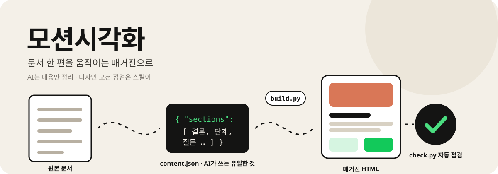
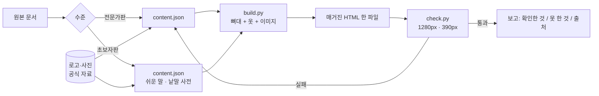
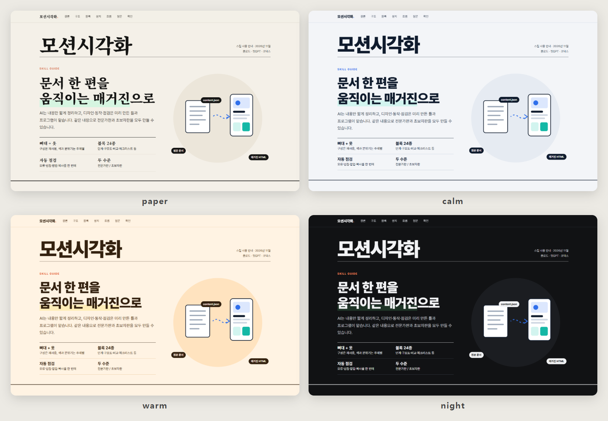
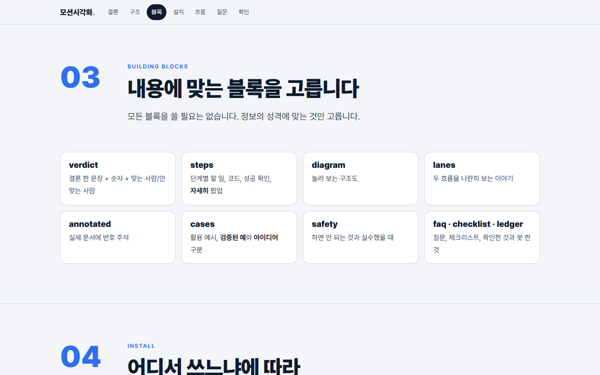
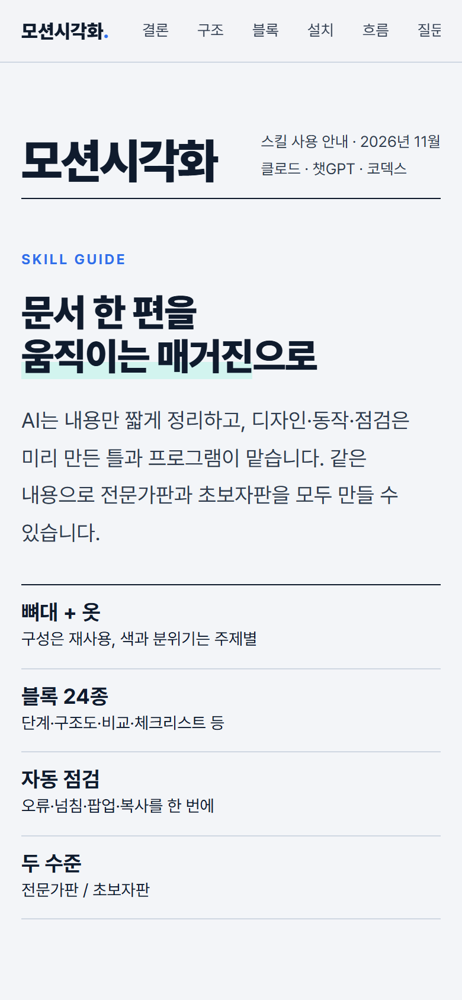

<p align="center">
  
</p>

<p align="center">
  <b>문서 한 편을 움직이는 매거진으로.</b><br>
  AI는 내용만 짧게 정리하고, 디자인·모션·점검은 스킬이 맡습니다.
</p>

<p align="center">
  
  
  
  
  
</p>

---

## 한눈에

| | 손으로 만들 때 | 모션시각화로 만들 때 |
|---|---|---|
| AI가 쓰는 것 | 페이지 전체(디자인·동작 코드 포함) | **`content.json` 하나** |
| 디자인 | 매번 새로 | 뼈대는 재사용, **옷(테마) 4벌** 중 선택 |
| 확인 | 화면 캡처를 여러 번 | **`check.py` 한 번** + 대표 캡처 2장 |
| 수준 | 한 가지 | **전문가판 / 초보자판** |

<p align="center"></p>

> 위 수치는 실제 측정한 **글자 수**입니다. 토큰 수와 금액은 측정하지 않았습니다.

---

## 어떻게 움직이나요



| 단계 | 누가 | 하는 일 |
|:-:|---|---|
| 1 | AI | 원본에서 결론·단계·주의점·확인한 것과 못 한 것을 뽑음 |
| 2 | 사용자 | 전문가판 / 초보자판 / 둘 다 (말하지 않으면 전문가판) |
| 3 | AI | 공식 홍보 자료에서 로고·사진, 출처 기록 |
| 4 | AI | 옷 고르기: `paper` · `calm` · `warm` · `night` |
| 5 | AI | **content.json 작성** |
| 6 | 자동 | `build.py`가 HTML 한 파일로 조립 |
| 7 | 자동 | `check.py`가 열어서 눌러 보고 캡처 |
| 8 | AI | 결과 보고 |

---

## 옷 4벌

같은 내용, 다른 옷입니다. `--theme`으로 바꾸고, `--accent "#2F6FEB"`로 강조색만 바꿀 수도 있습니다.

<p align="center"></p>

## 이렇게 나옵니다

<table>
<tr>
<td width="68%"></td>
<td width="32%"></td>
</tr>
<tr>
<td align="center">컴퓨터 (calm)</td>
<td align="center">휴대폰 390px</td>
</tr>
</table>

움직이는 것들: 스크롤하면 떠오르는 섹션, 올라가는 숫자, 흐르는 점선, 눌러 보는 구조도, 단계별 "자세히" 팝업, 복사 버튼, 진행률이 차오르는 체크리스트. 움직임을 줄이는 설정(`prefers-reduced-motion`)을 켜 둔 사람에게는 멈춘 화면으로 보입니다.

---

## 설치

| 쓰는 곳 | 방법 |
|---|---|
| **Claude Code** | `motion-visualization/` 폴더를 `~/.claude/skills/`에 복사 (프로젝트용은 `.claude/skills/`) |
| **Claude 웹·데스크톱** | [릴리스](https://github.com/dominkang90/motion-visualization/releases/latest)에서 `motion-visualization.zip`을 받아 → Customize → Skills → + → Create skill → Upload a skill. 설정에서 코드 실행이 켜져 있어야 합니다 |
| **ChatGPT** | Skills → Create → Upload from your computer |
| **Codex** | `~/.agents/skills/`에 복사, 또는 `$skill-installer https://github.com/dominkang90/motion-visualization/tree/main/motion-visualization` |

```bash
# Claude Code 예시
git clone https://github.com/dominkang90/motion-visualization.git
cp -r motion-visualization/motion-visualization ~/.claude/skills/
```

공식 안내: [Claude Code Skills](https://code.claude.com/docs/en/skills) · [Skills in ChatGPT](https://help.openai.com/en/articles/20001066-skills-in-chatgpt) · [Codex skills](https://developers.openai.com/codex/skills/create-skill)

## 사용

AI에게 원본 문서를 주고 이렇게 말하면 됩니다.

```text
이 문서 모션시각화로 만들어 줘
이 가이드 매거진으로, 초보자판도 같이
초등학생도 이해하게 매거진으로 만들어 줘
```

직접 실행하려면:

```bash
python motion-visualization/scripts/build.py motion-visualization/examples/skill-guide.json -o out.html --theme calm
python motion-visualization/scripts/check.py out.html --shots shots/
```

<details>
<summary><b>블록 24종 보기</b> (content.json에서 고르는 부품)</summary>

| 블록 | 쓰임 | 블록 | 쓰임 |
|---|---|---|---|
| `verdict` | 결론 + 숫자 + 맞는 사람 | `steps` | 단계, 코드, 성공 확인, 팝업 |
| `scenes` | 문제 두 장면 | `words` | 따라 말할 문장 + 복사 |
| `diagram` | 눌러 보는 구조도 | `lanes` · `timing` | 두 방향 흐름, 실제 시간 기록 |
| `chips` · `callout` | 강조 알약, 한 줄 약속 | `annotated` | 실제 문서에 번호 주석 |
| `dict` | 낱말 사전 | `cases` | 검증된 예 / 아이디어 구분 |
| `folders` · `rules` | 분류 카드, 번호 규칙 | `safety` · `pull` | 금지·실수 대처, 강조 인용 |
| `faq` · `agenda` | 접는 질문, 진행표 | `checklist` · `ledger` | 진행률, 확인한 것/못 한 것 |
| `figure` · `code` · `text` · `html` | 그림, 코드, 문단, 예외 | | |

전체 필드: [`references/content-format.md`](motion-visualization/references/content-format.md)
</details>

<details>
<summary><b>폴더 구조</b></summary>

```text
motion-visualization/
├─ SKILL.md                 AI가 읽는 사용 설명서 (짧게)
├─ assets/
│  ├─ template.html         뼈대 + 옷 4벌 + 모션 (AI는 읽지 않음)
│  └─ brands/<브랜드>/sources.json   로고 받는 곳과 사용 규칙
├─ scripts/
│  ├─ build.py              content.json → HTML 한 파일
│  └─ check.py              정적 점검 + (가능하면) 브라우저 점검
├─ references/              필요할 때만 여는 문서
│  ├─ content-format.md     블록 양식
│  ├─ beginner-rules.md     초보자판 규칙
│  ├─ image-sourcing.md     로고·사진 모으기
│  └─ pitfalls.md           실수 메모
└─ examples/                skill-guide.json, pickle-beginner.json
```
</details>

---

## 확인한 것과 못 한 것

| 확인함 (2026-11, Windows) | 아직 확인 못 함 |
|---|---|
| `build.py` 조립: 서로 다른 주제 2개, 전문가판·초보자판, 옷 4벌 | Claude 웹·ChatGPT·Codex에서 실제 설치와 실행 |
| `check.py`: 1280px·390px에서 오류·넘침·팝업·복사·체크리스트·질문 | macOS·Linux 실행 |
| 필수 칸이 빠진 content.json은 조립 단계에서 실패로 멈춤 | 인터넷이 끊긴 상태의 글꼴(기본 글꼴로 대체됨) |

**브라우저 점검 조건:** Playwright(파이썬)와 Chromium·Chrome·Edge 중 하나. 없으면 정적 점검만 하고 `SKIP`으로 알립니다.

## 로고와 상표

이 저장소에는 **다른 회사의 로고 파일이 들어 있지 않습니다.** `assets/brands/*/sources.json`에 공식 받는 곳과 사용 규칙만 적어 두었습니다. 로고는 각 회사의 상표이므로 공식 자료에서 직접 받아 규칙에 맞게 쓰세요. `pickle-beginner.json` 예시는 로고를 넣기 전까지 빈 점선 상자로 보입니다. 이 프로젝트는 Anthropic, OpenAI, GitHub, Pickle과 관계없는 개인 프로젝트입니다.

## 라이선스

[MIT](LICENSE). 단, 다른 회사의 로고·상표는 이 라이선스에 포함되지 않습니다.
